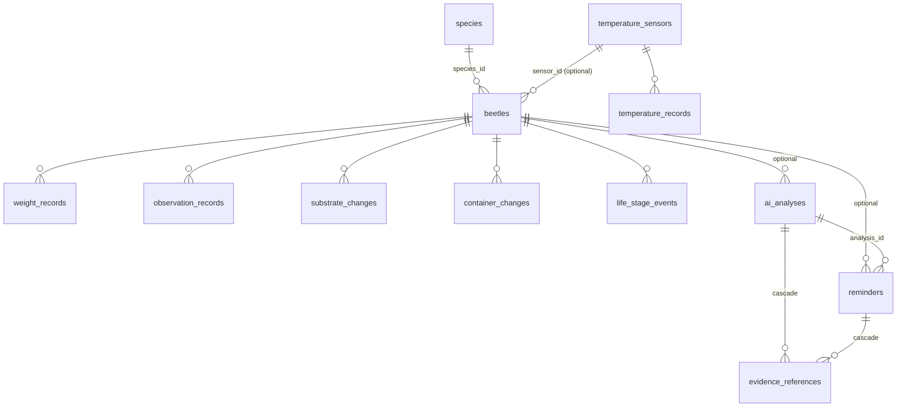

# Server schema (V001)

Every table: `id UUID PK`, `created_at`, `updated_at`, `deleted_at` (tombstone), `revision`,
`change_seq` (sync cursor). Trigger `touch_row()` maintains `updated_at`, `revision`, `change_seq`.

Device-only tables (not on the server): `photo_attachments` (files stay on the phone until photo sync
exists), `suggestion_suppressions`, `ai_provider_settings`, `app_settings`, `backup_imports`.

Notable constraints: beetle code `^[A-Z][A-Z0-9]{1,7}-[0-9]{3,6}$`; weight `0 < g < 1000`;
`l3_phase` only with stage `l3`; reminder status/source/basis enums; at most one live reminder per
`dedupe_key`.
